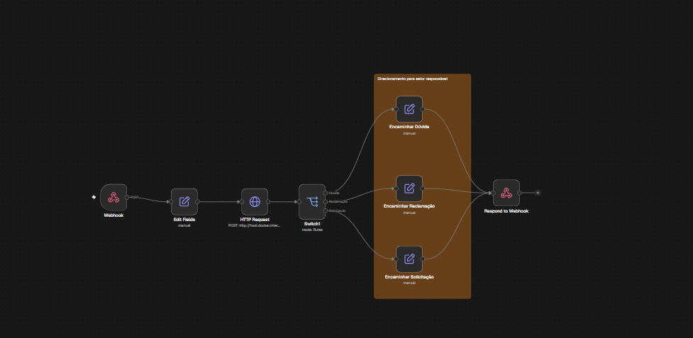
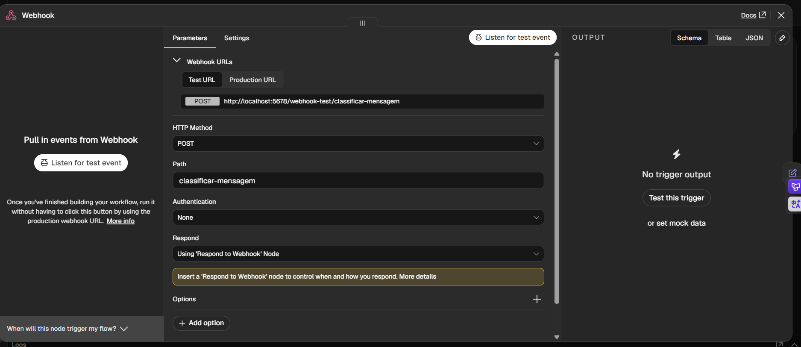
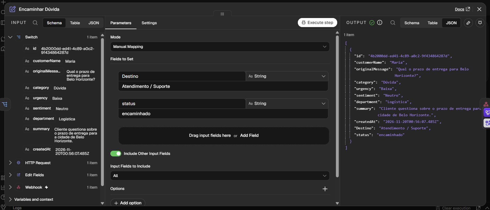
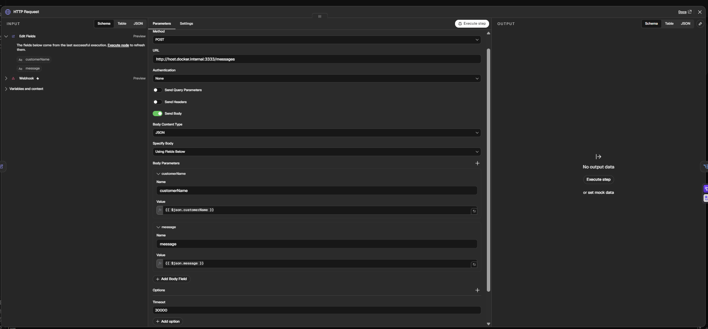
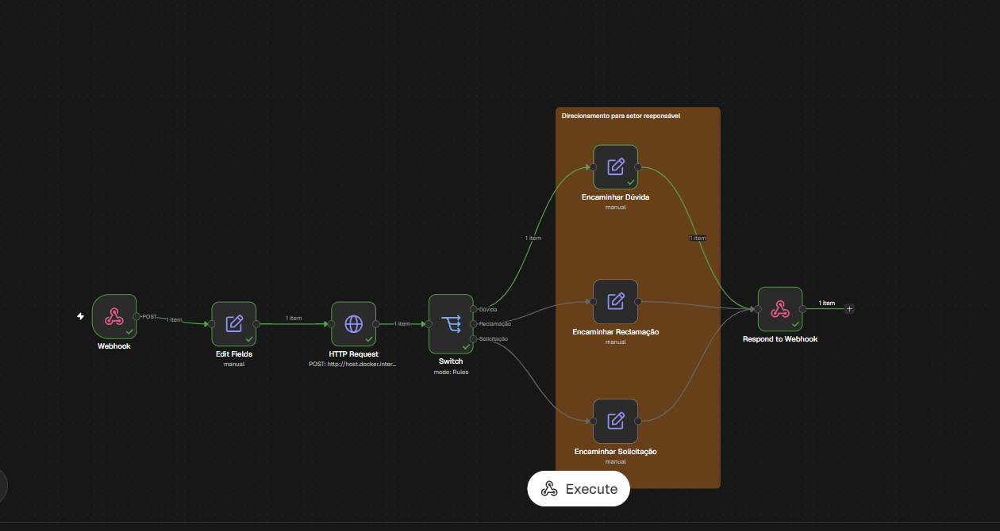
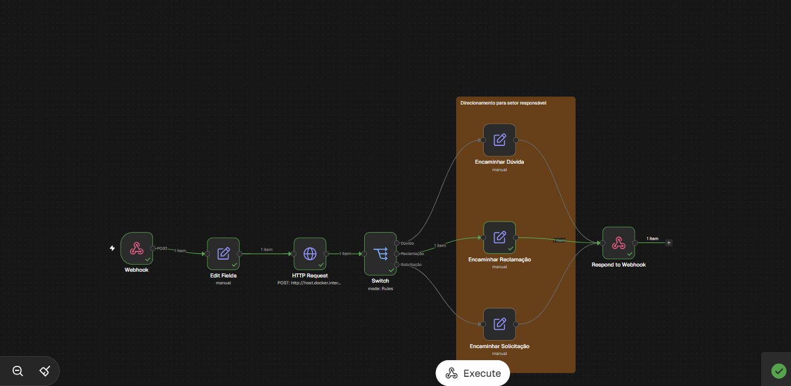
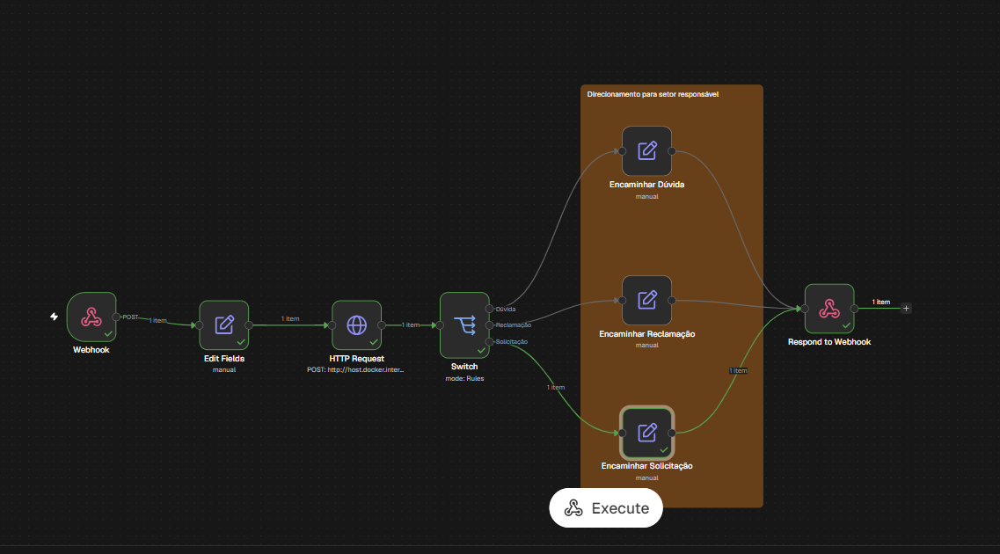

# KodiFlow — Classificação Inteligente de Mensagens com IA e Automação

Solução desenvolvida para o **Desafio Técnico de IA e Automação (KODIE)**, integrando Inteligência Artificial, API REST e fluxos automatizados para otimizar a triagem de mensagens no atendimento ao cliente.

[▶ Assistir demonstração do fluxo](https://youtu.be/29Wqgc7AWhQ?si=DqgTW2HCB7ygI-L9)

---

## 1. Apresentação da Ideia

O **KodiFlow** nasceu da necessidade de transformar processos manuais e repetitivos de atendimento ao cliente em fluxos ágeis, inteligentes e escaláveis. A ideia central é atuar como um motor de triagem cognitiva que recebe mensagens brutas, compreende o contexto semântico através de modelos de Inteligência Artificial e entrega os dados estruturados para que ferramentas de automação realizem o encaminhamento imediato sem intervenção humana inicial.

---

## 2. Problema Escolhido

**Cenário:** Classificação de Mensagens (Caso 4.1).

Pequenas e médias empresas recebem diariamente um alto volume de mensagens de clientes contendo dúvidas, solicitações diversas e reclamações. Quando esse processo é realizado manualmente:

* Há um consumo excessivo de tempo operacional na leitura individual de cada mensagem;
* Ocorre demora na identificação de casos críticos ou urgentes;
* A falta de padronização na categorização dificulta o direcionamento correto para os setores responsáveis.

---

## 3. Solução Proposta

O **KodiFlow** resolve esse gargalo unindo uma **API Back-end** a um **Fluxo de Automação**:

1. **Captura:** O fluxo de automação (n8n) intercepta a chegada da nova mensagem via Webhook.
2. **Processamento Cognitivo (IA):** A API recebe o texto e utiliza um modelo de Inteligência Artificial com engenharia de prompt estruturada para analisar o conteúdo.
3. **Classificação Estruturada:** A IA extrai a categoria (`Dúvida`, `Reclamação` ou `Solicitação`), o nível de urgência (`Baixa`, `Média`, `Alta`), o sentimento do cliente, o setor de destino e gera um resumo objetivo — devolvendo tudo estritamente em formato **JSON**.
4. **Roteamento Automatizado:** O n8n recebe o JSON validado da API e executa o encaminhamento automático para a fila ou setor correspondente.

---

## 4. Tecnologias Utilizadas

* **Back-end:** Node.js com TypeScript e framework **Express**.
* **Validação de Dados:** Zod (garantindo contratos rígidos de entrada e saída).
* **Inteligência Artificial:** API de LLM (Google Gemini) com prompt estruturado para saída em JSON.
* **Automação:** **n8n** (orquestração do fluxo via Webhook e HTTP Request).
* **Infraestrutura (Opcional/Diferencial):** Docker e Docker Compose para padronização do ambiente.

---

## 5. Funcionamento do Sistema

O fluxo de dados entre os componentes segue a arquitetura abaixo:

```text
[Cliente / Origem] 
       │
       ▼ (Payload JSON)
[n8n: Webhook Trigger] 
       │
       ▼ (POST /messages)
[API Express + Zod] ──► [Prompt Estruturado] ──► [Modelo de IA]
       │                                               │
       ◄─────────── (Resposta Estruturada JSON) ───────┘
       │
       ▼ (Retorno HTTP 200)
[n8n: Roteamento / Encaminhamento por Categoria]
```

### Contrato da API (`POST /messages`)

**Exemplo de Entrada (Enviado pelo n8n):**
```json
{
  "message": "Meu pedido atrasou mais de 5 dias e não recebi o código de rastreio.",
  "customerName": "Ana Souza"
}
```

**Exemplo de Saída (Retornado pela IA via API):**
```json
{
  "category": "Reclamação",
  "urgency": "Alta",
  "sentiment": "Negativo",
  "department": "Logística / Atendimento",
  "summary": "Cliente relata atraso de 5 dias na entrega e ausência de código de rastreio."
}
```

---

## 6. Como Executar

### Pré-requisitos

* Node.js (v20 ou superior)
* Gerenciador de pacotes (`pnpm` ou `npm`)
* Instância do **n8n** (local ou via Docker)
* Chave de API do provedor de IA escolhido

### Passo 1: Clonar o repositório e instalar dependências

```bash

git clone https://github.com/tatyanepgoncalves/kodiflow-backend.git
cd kodiflow-backend
pnpm install
```

### Passo 2: Configurar variáveis de ambiente

Crie um arquivo `.env` na raiz do projeto baseado no arquivo `.env.example`:

```bash
cp .env.example .env
```

Preencha as variáveis necessárias no `.env`:

```env
PORT=3333
AI_API_KEY=sua_chave_de_api_aqui
```

### Passo 3: Iniciar a API

```bash
pnpm run dev
```

O servidor estará disponível em `http://localhost:3333`.

### Passo 4: Configurar o Fluxo no n8n

1. Importe o arquivo JSON do fluxo localizado em [`docs/json/KodieFlow.json`](./docs/json/KodieFlow.json) (ou configure os nós `Webhook` e `HTTP Request`).
2. O nó `HTTP Request` do fluxo já está configurado para `http://host.docker.internal:3333/messages`. Em uma execução local sem Docker, use `http://localhost:3333/messages`.
3. Ative o fluxo e envie uma requisição de teste para o Webhook.

---

## 7. Documentação do Fluxo de Automação (n8n)

Esta seção documenta o fluxo implementado no n8n por meio de capturas de tela organizadas e acompanhadas de uma breve descrição de cada etapa.

### 7.1 Fluxo completo

O fluxo recebe a mensagem pelo Webhook `POST /classificar-mensagem`, prepara os dados, envia o conteúdo para a API Express, interpreta a classificação retornada pela IA e encaminha a mensagem para a saída correspondente.



### 7.2 Configuração dos nós

As capturas abaixo mostram as configurações internas utilizadas nos principais nós do fluxo:

1. **Webhook:** recebe as mensagens de entrada por HTTP e inicia a execução do fluxo.

   

2. **Edit Fields:** extrai `customerName` e `message` do corpo recebido pelo Webhook e prepara o payload enviado à API.

   

3. **HTTP Request:** envia um `POST` para `/messages`, com os campos `customerName` e `message`. O nó possui timeout de 30 segundos.

   

4. **Switch:** verifica o campo `category` retornado pela API e cria três saídas: `Dúvida`, `Reclamação` e `Solicitação`.
5. **Encaminhamento:** cada saída define o setor responsável e o status `encaminhado`:
   - `Dúvida` → Atendimento / Suporte
   - `Reclamação` → Ouvidoria / Pós-venda
   - `Solicitação` → Financeiro / Operações
6. **Respond to Webhook:** devolve o JSON final ao cliente que iniciou a requisição.

A classificação por IA ocorre na API Express chamada pelo nó `HTTP Request`; não há um nó de IA separado no workflow do n8n.

### 7.3 Execução bem-sucedida e resultados

Os prints abaixo demonstram execuções concluídas com sucesso. Em cada caso, é possível acompanhar os dados recebidos, a classificação processada pela API e o encaminhamento realizado pelo n8n:

#### Dúvida



#### Reclamação



#### Solicitação



Os nós de resultado preservam os dados relevantes recebidos e processados em cada etapa, permitindo verificar o caminho completo da mensagem desde o Webhook até o encaminhamento final.

## 8. Estrutura do README.md

Este README está organizado conforme os requisitos da documentação do projeto:

1. **Apresentação da ideia:** explica a origem e o objetivo do KodiFlow.
2. **Problema escolhido:** descreve o cenário de classificação de mensagens e suas dificuldades.
3. **Solução proposta:** apresenta como a API, a IA e o n8n participam do processo.
4. **Tecnologias utilizadas:** relaciona as ferramentas e tecnologias adotadas no desenvolvimento.
5. **Funcionamento do sistema:** explica o fluxo de dados, a arquitetura e o contrato da API.
6. **Como executar:** apresenta as instruções necessárias para instalar, configurar e executar o projeto.
